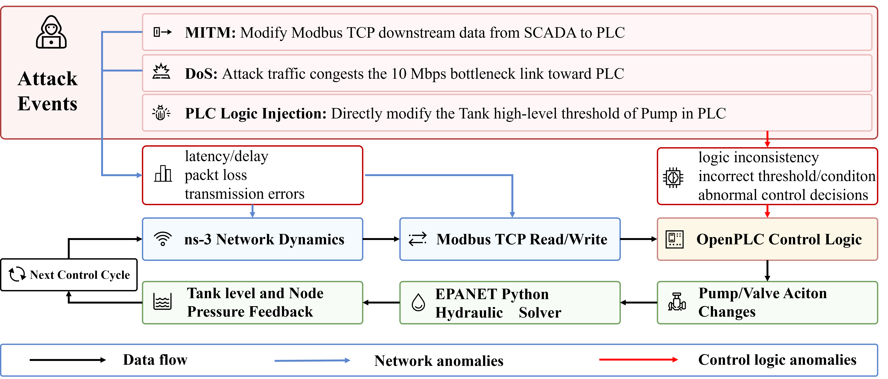

# Security Experiments

Hydro-CPS-Sim provides MITM, DoS and PLC logic injection attacks. You can select targets and active windows to explore how attacks affect sensor data, PLC outputs and the water network.

## Attack types

<figure>
<a href="../../assets/attack_cross_layer_propagation_paths.png" target="_blank" rel="noopener"></a>
<figcaption>MITM, DoS and PLC logic injection entry points in the closed loop.</figcaption>
</figure>

### MITM data manipulation

MITM modifies Modbus data exchanged between SCADA and PLCs. For example, changing T7 measurements sent to PLC4 changes the controller input and can affect the on/off decision for PU10.

### DoS communication interference

DoS uses UDP traffic to occupy network links and interfere with normal Modbus communication. After a timeout, SCADA may retain an earlier observation. Compare communication state, measurement updates and actuator actions to explore the effect of stale data on control.

### PLC logic injection

Logic injection changes PLC rules, such as a pump-off threshold. OpenPLC executes the modified rules, and resulting pump or valve actions feed back into the hydraulic model.

## Example configurations

The current version provides the following example configurations. Attack windows are measured in control iterations.

| Configuration | Target or purpose | Attack iterations |
| --- | --- | --- |
| [`config.yaml`](https://github.com/WandeF/hydro-cps-sim/blob/main/examples/c_town/config.yaml) | Baseline | — |
| [`config_mitm_plc4.yaml`](https://github.com/WandeF/hydro-cps-sim/blob/main/examples/c_town/config_mitm_plc4.yaml) | PLC4 downlink | 20–40 |
| [`config_mitm_plc9.yaml`](https://github.com/WandeF/hydro-cps-sim/blob/main/examples/c_town/config_mitm_plc9.yaml) | PLC8 T7 response | 20–40 |
| [`config_mitm_composite_plc7_plc9.yaml`](https://github.com/WandeF/hydro-cps-sim/blob/main/examples/c_town/config_mitm_composite_plc7_plc9.yaml) | PLC6 T5 + PLC8 T7 | 20–40 / 30–50 |
| [`config_dos_plc2_single.yaml`](https://github.com/WandeF/hydro-cps-sim/blob/main/examples/c_town/config_dos_plc2_single.yaml) | PLC2, single attack endpoint | 5–90 |
| [`config_dos_plc2_three_bots.yaml`](https://github.com/WandeF/hydro-cps-sim/blob/main/examples/c_town/config_dos_plc2_three_bots.yaml) | PLC2, three attack endpoints | 5–90 |
| [`config_openplc_logic_plc4.yaml`](https://github.com/WandeF/hydro-cps-sim/blob/main/examples/c_town/config_openplc_logic_plc4.yaml) | T7 threshold for PU10 at PLC4 | 20–90 |

Each configuration includes its network, control and attack settings. Start with an example and adjust the target, attack parameters and active window.

## Running an experiment

Run an attack-free baseline first:

```bash
bash scripts/run_all.sh --config examples/c_town/config.yaml
```

Save the baseline output, then select an attack configuration:

```bash
bash scripts/run_all.sh --config examples/c_town/config_mitm_plc4.yaml --logic-wait 0.3
```

Each run updates the output directory. Copy results you want to compare to a separate directory before starting the next experiment.

## Reading the results

Results are saved under `output_path` in `reports/csv/`.

| File | Contents |
| --- | --- |
| `physics.csv` | Hydraulic states, including levels and pressures |
| `actuator_state.csv` | Pump and valve states |
| `scada_observed_long.csv`, `scada_observed_wide.csv`, `scada_observed_key.csv` | SCADA observations |
| `attack_schedule.csv`, `attack_events.csv` | Attack scheduling and events |
| `scada_timeout_events.csv` | Communication timeouts |
| `cycle_timing.csv` | Timing of closed-loop stages |

When comparing an attack run with its baseline, start with input changes, then inspect PLC outputs and hydraulic states. A timeout need not change an actuator action, and an input change may trigger a control rule in a later iteration.

You can compare levels and pressures using RMSE, mean absolute deviation or peak absolute deviation. Use `sim_time` from the hydraulic records when plotting against physical time. See [Configuration](configuration.html) for network and control settings.

## Extended experiments

For power, thermal or custom physical models, see [Extended Experiments](extensions.html) and [UPSI Configuration](upsi-configuration.html).
