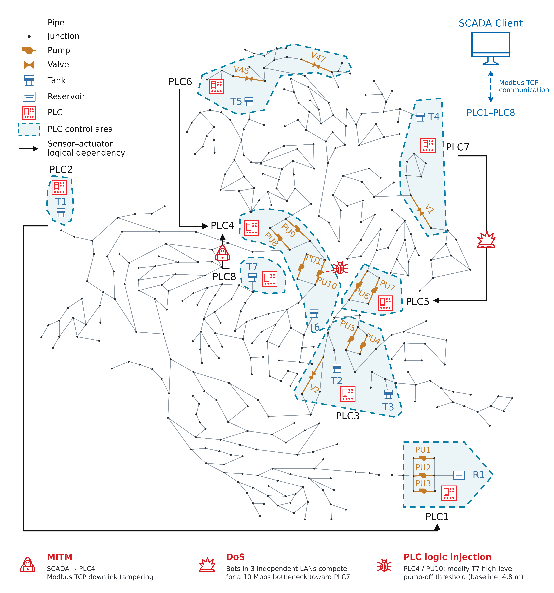

# Introduction

## Water cyber-physical systems

A water cyber-physical system connects a distribution network with sensors, controllers and communication networks. Sensors measure tank levels, pressures and flows. PLCs use these measurements to control pumps and valves, while SCADA monitors the system and forwards data. Actuator actions change the network state, and new measurements enter the next control cycle.

Studying security in these systems involves network communication, control programs and hydraulics together. Modified sensor data can change a pump decision, while a communication failure can leave a controller using an earlier measurement.

## Platform overview

Hydro-CPS-Sim is a co-simulation platform for water-system security research. It connects EPANET hydraulics, OpenPLC programs, Modbus TCP communication and ns-3 networking in one closed loop, with support for MITM, DoS and PLC logic injection experiments.

You can select a water model, control rules, network topology and attack scenario through configuration files. The platform starts the components, coordinates data exchange and hydraulic computation, and saves logs and CSV results. Source code is available in the [GitHub repository](https://github.com/WandeF/hydro-cps-sim).

## Platform components

### Hydraulic simulation

DHALSIM-epynet / EPANET computes tank levels, node pressures and pipe flows. Pump and valve states from the PLCs update the hydraulic model, so control changes affect subsequent hydraulic states.

### PLCs and SCADA

OpenPLC executes Structured Text (ST) control programs. SCADA reads sensor measurements over Modbus TCP and forwards cross-PLC dependencies to the relevant controllers. PLC Adapters connect hydraulic data with PLC inputs and outputs.

### Communication network

Linux network namespaces provide separate network environments for PLC, SCADA and attack endpoints. TAP/veth interfaces connect them to ns-3, where you can configure link bandwidth, delay and topology.

### Attacks and logging

The platform provides Modbus data manipulation, UDP DoS and PLC logic injection. Attacks can act on communication data, network paths or control rules. Sensor observations, actuator states, attack events and hydraulic variables are recorded during execution for comparison across experiments.

## C-Town example

The C-Town example contains several PLC control regions. Some controllers use tank measurements acquired in other regions, with SCADA forwarding the data.

<figure>

<figcaption>C-Town network topology, PLC control regions and cross-region data dependencies.</figcaption>
</figure>

### Logical relationships between PLCs

| Measurement source | Control dependency forwarded through SCADA |
| --- | --- |
| T1 at PLC2 | PU1 and PU2 at PLC1 |
| T2 and T3 at PLC3 | Local V2, PU4 and PU5 |
| T5 at PLC6 | PU8 at PLC4 |
| T7 at PLC8 | PU10 and PU11 at PLC4 |
| T4 at PLC7 | PU6 and PU7 at PLC5 |

PLC4 also monitors local T6 and uses T5 and T7 measurements to control the corresponding pumps.

## Requirements and extension

The platform runs on Ubuntu and uses Python to coordinate hydraulic, control and network components. Components are organized into separate modules. You can adjust scenarios through YAML configuration or extend the control, network and attack modules. See [Installation](installation.html) for requirements and [Quick Start](quickstart.html) for your first experiment.
