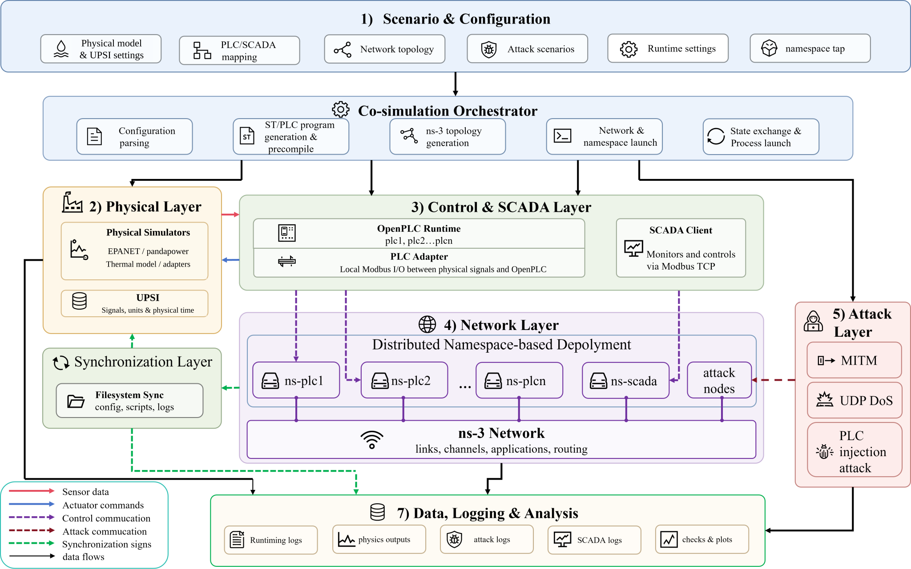

# UPSI Principles & Interface

UPSI (Unified Physical Simulation Interface) connects physical simulators to Hydro-CPS-Sim. Use EPANET for water, pandapower for power systems, or add a model of your own.

## Connect a physical model

A model supplies measurements and accepts controller outputs. A water network supplies levels, pressures and flows and accepts pump/valve commands. A thermal box supplies temperature and accepts a heater command.

Their equations differ, but their role in the loop is the same. UPSI provides methods to describe variables, initialize, step and finish. An adapter calls the solver while the platform keeps the same PLC, SCADA and network workflow.

<figure><figcaption>UPSI connects physical simulators to the existing loop.</figcaption></figure>

## Follow one control cycle

The model produces measurements. PLCs receive them, SCADA forwards remote dependencies, and PLC rules produce commands. The platform returns those commands to the model to calculate its next state.

```text
measurements → PLC / SCADA → commands → physical model → new measurements
```

The adapter uses native model variables; scenes use logical sensor/actuator names. SignalMapper connects them and applies unit conversions. Changing the model mainly changes the adapter and scene settings.

## Adapter methods

Inherit PhysicsBackend and implement:

| Method | Purpose |
| --- | --- |
| describe() | List readable/writable variables, types, units and stepping behavior |
| initialize() | Load the model, apply initial inputs and return its initial state |
| advance(until_s, inputs) | Apply inputs, advance and return the result |
| close() | Release model resources |

BackendConfig supplies paths, model settings, working directory, interval and initial inputs. SignalSpec describes variables; StepResult contains time, outputs, applied inputs and status.

Repeated initialize calls should not restart the model. Close should work after normal completion or partial initialization. See [Add a Physical Simulator](adapter-guide.html).

## Variables and units

| Logical name | Native example | Measurement/input |
| --- | --- | --- |
| T1 | node.T1.level | Tank level |
| V_BUS02 | res_bus.BUS_02.vm_pu | Bus2 voltage |
| P_GRID | metrics.total.p_grid_mw | Grid active power |
| TEMPERATURE | box.temperature | Box temperature |
| HEATER | heater.enabled | Heater enable |

Ports have input/output direction and float/int/bool/str type. The existing PLC transport uses float observations and BOOL commands. Other types can use standalone model calls and need suitable bindings for PLC transport.

Floats use logical = native*scale+offset; commands use the inverse. MW→kW uses scale 1000, degC→K offset 273.15. BOOL mappings may invert polarity.

Specify units and conversion coefficients. Converting pu to volts also needs the model's base voltage; water-column pressure needs density and gravity. See [UPSI Configuration](upsi-configuration.html).

## Time and stepping

The platform requests until_s and the model returns actual time_s. Target backends reach the target; event_step backends may return at an internal event before continuing with another step.

EPANET can advance through hydraulic events, pandapower solves the current AC operating point, and the thermal model integrates temperature. Returning actual time lets these methods use the same loop.

Controller iteration, physical seconds and process duration are recorded separately. Use sim_time for physical curves and iteration to find matching communication/control records.

## Measurement status

Results may include source time, quality, validity and freshness. A disconnected bus can have zero voltage marked unsupplied. Cached measurements after a network timeout retain their original source time.

quality_policy selects pass-through, hold-last, skip or stop behavior at the control boundary. The physical record keeps the model's calculated result. Adapters should return complete valid outputs and raise an error when solving fails; the platform checks and records the result before continuing.

## Plugins

EPANET and pandapower are built in. Register an independent module or installed package using physics.plugins. A scene selects one backend.

Plugin selection, signal mappings and control rules are separate settings. Adding a model usually needs no scheduler, Modbus or attack-code changes. Try the [thermal example](extended-examples.html), then follow the [adapter tutorial](adapter-guide.html).

## Further reading

UPSI is the project's Python interface. These documents introduce related simulation, configuration and communication methods:

| Document | Topic |
| --- | --- |
| [FMI 3.0.2](https://fmi-standard.org/docs/3.0.2/) | Lifecycle, variables, units and co-simulation stepping |
| [mosaik API](https://mosaik.readthedocs.io/en/latest/mosaik-api/high-level.html) | Connecting different simulators to one experiment |
| [Python entry points](https://docs.python.org/3.10/library/importlib.metadata.html#entry-points) | Discovering installed plugins |
| [YAML](https://yaml.org/spec/1.2.2/) / [PyYAML](https://pyyaml.org/wiki/PyYAMLDocumentation) | Scene syntax and parsing |
| [Modbus](https://www.modbus.org/file/secure/modbusprotocolspecification.pdf) | Registers, coils and function codes |

UPSI adapters implement this project's API. An FMU adapter would additionally handle FMI calls/capabilities; simultaneous model coupling also needs inter-model exchange and time coordination.
