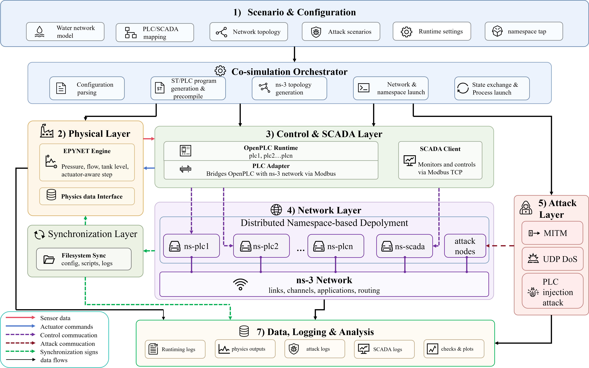
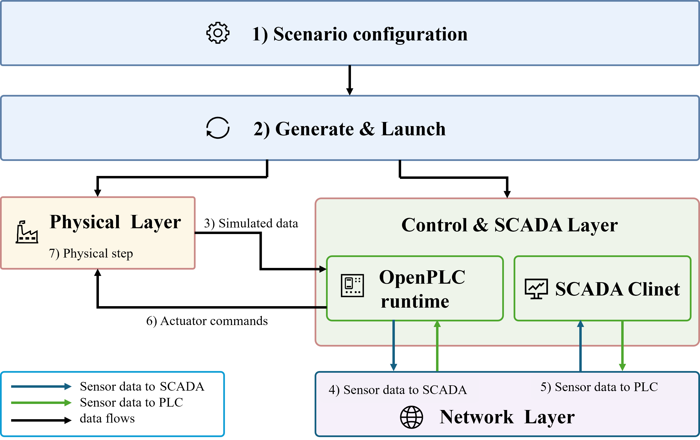

# 系统架构

Hydro-CPS-Sim 将水力求解、可执行 PLC 程序、工业协议与网络路径连接为闭环。攻击从协议、网络或控制入口介入，再经控制判断和执行器反馈影响水力状态。

## 平台总体架构

<figure>

<figcaption>平台总体架构。图来自项目论文工作稿；点击可查看原图。</figcaption>
</figure>

| 模块 | 实现与职责 |
| --- | --- |
| 场景配置 | YAML 描述水网、PLC/SCADA 映射、控制规则、网络、攻击与运行参数 |
| 联合仿真编排 | 生成 ST 程序、编译 PLC、生成网络环境、启动进程并导出结果 |
| 物理过程 | DHALSIM-epynet / EPANET 推进水力状态，接收泵阀动作 |
| 控制与监控 | OpenPLC 执行控制逻辑；PLC Adapter 衔接输入输出；SCADA 通过 Modbus TCP 采集与转发数据 |
| 网络通信 | Linux network namespace 提供独立网络身份，经 TAP/veth 接入 ns-3 |
| 攻击执行 | 在配置的协议、网络或控制入口执行 MITM、DoS 或逻辑注入 |
| 同步 | 通过文件系统标志协调多进程，按实验轮次交换状态 |
| 数据记录 | 汇集攻击、通信、控制、执行器与水力记录，供基线对照使用 |

## 闭环运行流程

<figure>

<figcaption>闭环运行的概念流程。实现细节与执行顺序以对应版本运行器为准。</figcaption>
</figure>

1. **环境生成**：读取水网和 YAML 配置，生成控制程序、地址映射、ns-3 拓扑与命名空间配置。
2. **初始化**：启动 OpenPLC、SCADA 与网络进程，准备物理状态和同步目录。
3. **采集与转发**：水力模块提供当前传感器状态，SCADA 通过 Modbus TCP 采集数据并转发跨 PLC 控制依赖。
4. **控制执行**：OpenPLC 根据当前输入和有效规则生成泵阀命令。
5. **水力反馈**：执行器状态进入下一步水力求解，产生新的水位、压力和流量。
6. **记录与对照**：保存该轮数据，推进下一轮，并在运行后与同条件基线对齐。

这里的“轮次”用于模块协调；物理时间应读取水力引擎的 `sim_time`。内部事件可能缩短水力步长，不能直接将轮次乘以名义步长作为真实时间。

## 独立网络节点与协议交互

每个 PLC、SCADA 和攻击节点运行在各自的 Linux network namespace 中，拥有独立接口和协议栈。ns-3 为这些端点提供可配置的链路、路由与网络动态。正常 Modbus 通信和攻击流量通过配置的网络路径交互。

这种部署保留了 PLC 程序执行、寄存器/线圈映射、协议请求与响应、超时及数据保持等中间环节。它使研究者能够观察通信异常是否改变控制输入，以及输入变化是否真正触发执行器动作。

OpenPLC 是软件 PLC，命名空间中的节点仍共享主机资源。该平台不等同于工业硬件的实时调度、现场 I/O 或完整设备协议栈；不能仅凭拓扑隔离推断非目标节点绝不受间接影响。

## 代码入口

- `scripts/run_all.sh`：环境准备、运行和清理的总入口。
- `src/control/`：ST 程序生成、编译与 OpenPLC 启动。
- `src/network/`：命名空间与 ns-3 拓扑生成。
- `src/runtime/`、`src/sync/`：闭环协调与同步。
- `src/scada/`、`src/plc/`、`src/comm/`：数据采集、适配与 Modbus 交互。
- `src/attack/`：攻击启动与执行。
- `src/io/`：水力接口与结果导出。

设计说明参考项目论文工作稿的架构与实现章节。运行接口核对版本：[hydro-cps-sim @ 2406aa6](https://github.com/WandeF/hydro-cps-sim/tree/2406aa649738c585e635b3661d1b9431db73edb8)。
