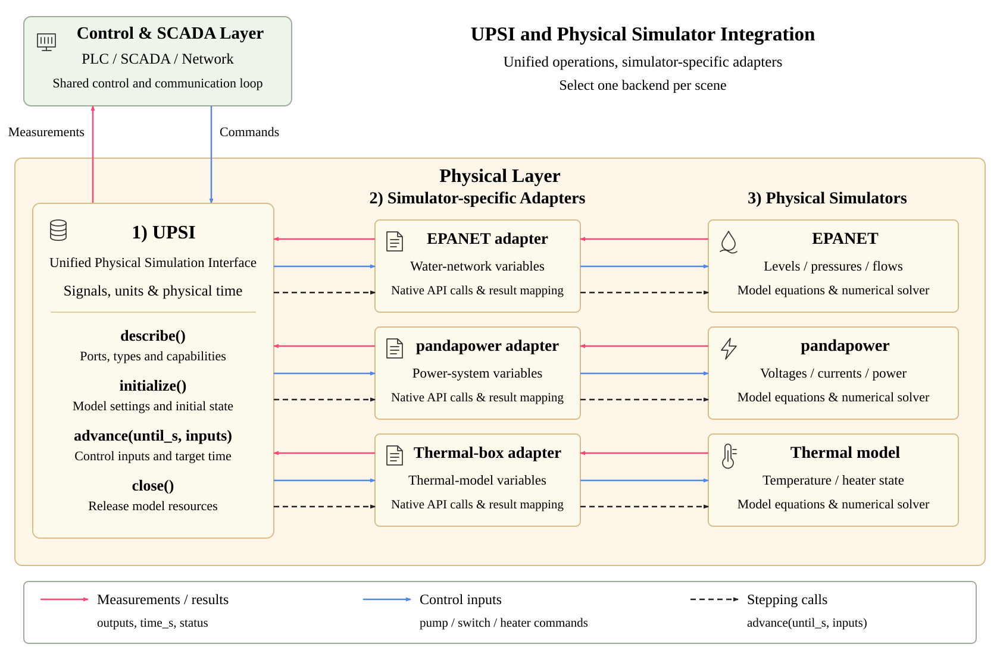

# UPSI 原理与接口

UPSI（Unified Physical Simulation Interface）用于连接不同的物理仿真器。你可以使用 EPANET 运行水网，使用 pandapower 运行电网，也可以添加自己的物理模型。

## 模型如何连接到平台

物理模型向平台提供测量值，并接收控制器的输出。例如，水网提供水位、压力和流量，接收泵阀命令；恒温箱提供温度，接收加热开关。

这些模型的方程和求解方法不同，但在闭环中的作用相同。UPSI 约定了描述变量、初始化、步进和结束运行的方法。适配器负责调用具体求解器，平台继续使用相同的 PLC、SCADA 和网络流程。

<figure><figcaption>UPSI 通过各仿真器的适配器读写物理模型。红色为测量与计算结果，蓝色为控制输入，黑色虚线为步进调用；每个场景选择一个后端。</figcaption></figure>

## 一次控制过程

每轮运行中，物理模型先给出当前测量。平台将测量送入 PLC，SCADA 负责采集和转发远程依赖。PLC 执行控制规则后，平台读出命令并交回模型，计算下一状态。

```text
物理测量 → PLC / SCADA → 控制命令 → 物理模型 → 新测量
```

适配器使用模型自己的变量名，场景使用传感器和执行器名称。`SignalMapper` 将两者连接起来，并完成需要的单位转换。这样，更换模型时主要修改适配器和场景配置。

## 适配器提供哪些方法

适配器继承 `PhysicsBackend`，实现四个方法：

| 方法 | 做什么 |
| --- | --- |
| `describe()` | 列出模型可以读取和写入的变量，包括类型、单位和步进方式 |
| `initialize()` | 加载模型、设置初始输入，返回初始状态 |
| `advance(until_s, inputs)` | 应用控制输入，推进模型并返回计算结果 |
| `close()` | 释放模型资源 |

`BackendConfig` 提供场景路径、模型设置、运行目录、步长和初始输入。`SignalSpec` 描述变量，`StepResult` 保存每次计算返回的时间、输出、实际输入及状态。

重复调用 initialize 不应重新开始仿真。close 应能在正常结束或初始化出错后使用。完整写法见[接入物理仿真器](adapter-guide.html)。

## 变量与单位

| 场景中的名字 | 模型端口示例 | 用途 |
| --- | --- | --- |
| T1 | node.T1.level | 水箱水位 |
| V_BUS02 | res_bus.BUS_02.vm_pu | Bus2 电压 |
| P_GRID | metrics.total.p_grid_mw | 网侧有功功率 |
| TEMPERATURE | box.temperature | 箱内温度 |
| HEATER | heater.enabled | 加热开关 |

每个端口有输入或输出方向，以及 float、int、bool 或 str 类型。现有 PLC 通信使用 float 测量和 bool 命令。其他类型可用于独立模型调用，连接 PLC 时需要相应的数据绑定。

浮点变量可以通过 `logical = native * scale + offset` 换算单位，命令使用逆变换。例如 MW 转 kW 使用 scale 1000，摄氏温度转 K 使用 offset 273.15。布尔命令可以使用 invert 改变极性。

单位和换算系数需要明确填写。pu 电压换成 V 还需要模型基值；水柱压力转换需要密度和重力加速度。字段说明见 [UPSI 配置](upsi-configuration.html)。

## 时间与模型步进

平台请求模型推进到 `until_s`，模型返回实际到达的 `time_s`。普通模型使用 target，推进到目标时间；有内部事件的模型可以使用 event_step，在事件处先返回，再继续下一次推进。

EPANET 可能按水力事件推进；pandapower 每次计算当前运行点的 AC 潮流；恒温箱对温度方程积分。UPSI 使用返回的实际时间，让这些求解方式都能接入闭环。

控制轮次、物理秒数和程序运行耗时分别记录。画物理曲线时使用 sim_time，查看通信或控制过程时可以按 iteration 查找。

## 如何处理测量状态

结果除了测量值，还可以带源时间、quality、validity 和 freshness。例如，负荷母线失电时，电压为 0 并标记 unsupplied；网络超时后继续使用的旧测量保留原来的源时间。

你可以选择直接使用数据、保持上次成功写入值、跳过写入或在异常时停止。它们通过 quality_policy 设置，作用于控制侧的数据处理，物理结果仍按模型计算值保存。

编写适配器时，返回完整且有效的结果；求解出错时抛出异常。平台负责检查结果、保存数据和协调下一轮运行。

## 插件与扩展

EPANET 和 pandapower 是内置后端。自己的适配器可以放在独立模块或安装包中，通过 physics.plugins 注册。每个场景选择一个后端。

插件的选择、变量映射和控制规则分别配置。添加新模型时，通常不需要修改主调度、Modbus 或攻击代码。先尝试[恒温箱示例](extended-examples.html)，再按照[适配器教程](adapter-guide.html)接入自己的求解器。

## 进一步阅读

UPSI 是项目提供的 Python 接口。下面的文档介绍了相关的联合仿真、配置和通信方法：

| 文档 | 阅读内容 |
| --- | --- |
| [FMI 3.0.2](https://fmi-standard.org/docs/3.0.2/) | 仿真模型的生命周期、变量、单位和联合仿真步进 |
| [mosaik Simulator API](https://mosaik.readthedocs.io/en/latest/mosaik-api/high-level.html) | 将不同仿真器连接到同一实验的接口设计 |
| [Python entry points](https://docs.python.org/3.10/library/importlib.metadata.html#entry-points) | 安装包中的插件发现与加载 |
| [YAML](https://yaml.org/spec/1.2.2/) 与 [PyYAML](https://pyyaml.org/wiki/PyYAMLDocumentation) | 场景文件的语法与解析 |
| [Modbus Application Protocol](https://www.modbus.org/file/secure/modbusprotocolspecification.pdf) | PLC 寄存器、线圈和功能码 |

UPSI 的适配器使用本项目的接口；接入 FMU 仍需编写处理 FMI API 和模型能力的适配器。多个物理模型同时耦合也需要进一步设置时间协调与模型间的数据交换。
